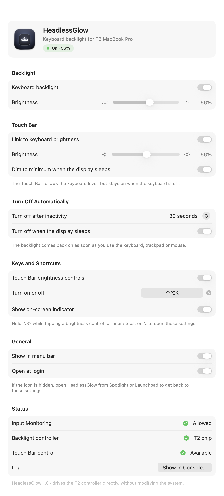
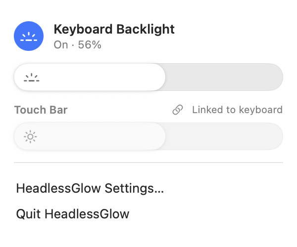

<div align="center">


# HeadlessGlow

Retroiluminación del teclado y brillo de la Touch Bar para MacBook Pro con chip T2 sin pantalla.

[](https://github.com/OnixBrave/HeadlessGlow/actions/workflows/build.yml)
[](https://github.com/OnixBrave/HeadlessGlow/releases/latest)
[](#compatibilidad)
[](LICENSE)
[](https://github.com/OnixBrave/HeadlessGlow/stargazers)
[](#apoyar-el-proyecto)

[Descargar](https://github.com/OnixBrave/HeadlessGlow/releases/latest) · [Instalación](#instalación) · [Uso](#uso) · [Apoyar](#apoyar-el-proyecto)

[English](README.md) · [Français](README.fr.md) · Español · [Deutsch](README.de.md) · [Italiano](README.it.md) · [Português](README.pt-BR.md) · [Русский](README.ru.md) · [简体中文](README.zh-CN.md) · [日本語](README.ja.md)

<br>

<picture>
  <source media="(prefers-color-scheme: dark)" srcset="docs/settings-dark.png">
  
</picture>
&nbsp;&nbsp;
<picture>
  <source media="(prefers-color-scheme: dark)" srcset="docs/menu-dark.png">
  
</picture>

</div>

## Por qué

Al quitar la pantalla de un MacBook Pro con chip T2 también se quita el sensor de luz ambiental, que está en la placa de la cámara. macOS deja entonces de controlar la retroiluminación del teclado: las teclas de brillo no hacen nada y el teclado se queda apagado. HeadlessGlow controla la retroiluminación directamente a través del chip T2.

## Funciones

- Retroiluminación encendida al iniciar sesión, restaurada tras el reposo y apagada cuando la pantalla entra en reposo
- Teclas de brillo de la Touch Bar: 16 niveles, <kbd>⌥</kbd><kbd>⇧</kbd> para pasos más finos, <kbd>⌥</kbd> para abrir los ajustes
- Se apaga tras un periodo de inactividad y se vuelve a encender al pulsar una tecla o mover el ratón
- Atajo para encender y apagar (<kbd>⌃</kbd><kbd>⌥</kbd><kbd>K</kbd> por defecto)
- Atenuación de la Touch Bar, opcionalmente vinculada al nivel del teclado
- Panel en la barra de menús, ventana de ajustes e indicador en pantalla
- Herramienta de línea de comandos `headlessglow`
- Interfaz en inglés y francés

## Compatibilidad

MacBook Pro Intel con chip T2 (2018–2020), macOS 13 o posterior.

| macOS | Estado |
|---|---|
| 26 | Probado en un MacBookPro16,1 (16 pulgadas, 2019) |
| 15 | [Pruebas de arranque automáticas](https://github.com/OnixBrave/HeadlessGlow/actions/workflows/build.yml) superadas |
| 13, 14 | Compila, sin probar |

Los resultados en otros modelos son bienvenidos en las [issues](https://github.com/OnixBrave/HeadlessGlow/issues).

## Instalación

Desde una release: descarga el zip de la [página de releases](https://github.com/OnixBrave/HeadlessGlow/releases/latest), ábrelo y ejecuta:

```sh
cd ~/Downloads/HeadlessGlow-<version> && ./install.sh
```

Desde el código fuente (requiere Xcode 26):

```sh
git clone https://github.com/OnixBrave/HeadlessGlow.git && cd HeadlessGlow
./tools/setup-signing.sh   # opcional: conserva el permiso entre actualizaciones
./install.sh
```

Después, permite HeadlessGlow en *Ajustes del Sistema → Privacidad y seguridad → Monitorización de los dispositivos de entrada*. Solo hace falta para las teclas de la Touch Bar, que se leen en modo de solo escucha.

> [!NOTE]
> La app no está notarizada, así que `install.sh` quita el atributo de cuarentena de la app que instala. Las releases están firmadas ad hoc: macOS vuelve a pedir el permiso tras cada actualización.

<details>
<summary>Qué se instala</summary>
<br>

Todo va en tu carpeta de inicio, sin `sudo`.

| Qué | Dónde |
|---|---|
| App | `~/Applications/HeadlessGlow.app` |
| Comando | `~/.local/bin/headlessglow` |
| Servicio de inicio de sesión | `~/Library/LaunchAgents/io.github.onixbrave.headlessglow.plist` |
| Ajustes | `defaults read io.github.onixbrave.headlessglow` |
| Registro | `~/Library/Logs/HeadlessGlow.log` |

`setup-signing.sh` crea un certificado de firma de código autofirmado en tu llavero de inicio de sesión, para que la app conserve la misma identidad entre compilaciones. `uninstall.sh` lo elimina.

</details>

## Uso

Usa los controles de brillo del teclado de la Touch Bar, el icono de la barra de menús, el atajo o la línea de comandos:

```text
headlessglow get                  muestra el estado
headlessglow set <0-100>          ajusta el nivel (0 lo apaga)
headlessglow on | off | toggle
headlessglow touchbar <10-100 | link | unlink>
headlessglow reload               vuelve a leer los ajustes tras un `defaults write`
```

Si ocultas el icono de la barra de menús, abre HeadlessGlow desde Spotlight para volver a los ajustes.

## Cómo funciona

El T2 expone la retroiluminación como interfaces HID propietarias del dispositivo `05AC:8102`. HeadlessGlow les envía feature reports, los mismos que usa el driver `hid-apple` de Linux. No se escribe nada de forma permanente, y no hace falta modificar SIP, ni extensiones del kernel, ni permisos de administrador.

<details>
<summary>Detalles</summary>
<br>

| Interfaz | Report | Contenido |
|---|---|---|
| `0xFF00:0x0F` (teclado) | ID 1 | brillo `u32` (100…14660), fundido `u32` (ms) |
| | ID 3 | encendido `u8` (0/1), fundido `u32` (ms) |
| `0xFF12:0x01` (Touch Bar) | ID 1 | estado, nivel de atenuación, factor de brillo `u32` (0…1000) |

El factor de la Touch Bar solo permite atenuarla; macOS también lo reescribe cuando la atenúa por su cuenta, así que HeadlessGlow vuelve a aplicar el ajuste tras cada reactivación. La detección de inactividad usa `HIDIdleTime`, y las teclas de brillo se leen con un event tap de solo escucha.

</details>

## Desinstalación

```sh
./uninstall.sh
```

Elimina la app, el comando, el servicio de inicio de sesión, los ajustes, el permiso, el certificado de firma y los registros.

<details>
<summary>Solución de problemas</summary>
<br>

- `headlessglow get` muestra lo que informa el T2.
- La sección *Status* de los ajustes muestra el permiso y el estado de los controladores, y abre el registro.
- Registro detallado: `defaults write io.github.onixbrave.headlessglow debugLog -bool YES` y luego `headlessglow reload`.

</details>

<details>
<summary>Desarrollo</summary>
<br>

- `./build.sh` compila la app; `./tools/package.sh` genera el zip de la release. Al subir una etiqueta `v*`, GitHub Actions compila, prueba y publica una release.
- `./tools/update-strings.sh` sincroniza el catálogo de traducciones con el código.
- `headlessglow --snapshot <carpeta>` guarda las ventanas de la app en PNG.
- El acceso al hardware está en `src/core/kbhw.c`; la app está escrita en Swift y SwiftUI.

</details>

## Créditos

- Formato de los reports del teclado: el driver `hid-apple` de Linux y la comunidad [t2linux](https://t2linux.org).
- [KBPulse](https://github.com/EthanRDoesMC/KBPulse) de EthanRDoesMC, por el trabajo previo sobre CoreBrightness.

## Apoyar el proyecto

HeadlessGlow es gratuito. Las donaciones son bienvenidas:

| Moneda | Red | Dirección |
|---|---|---|
| Bitcoin | Bitcoin | `bc1qsmpzq2hzruf2lgpexz4wtg0p0c0t8uxujnckfw` |
| ETH, USDC, USDT | Ethereum, Base, Arbitrum, Optimism | `0x2860E6465E03E714e4eCa092DcaeCCE2CE601D1C` |
| Litecoin | Litecoin | `LeDfGzBNgJGJURon1LCizT9n8LshTThBjD` |

Comprueba la red antes de enviar. Dar una estrella al repositorio también ayuda.

## Aviso

HeadlessGlow usa interfaces de hardware no documentadas y solo se ha probado en un modelo. Úsalo bajo tu propia responsabilidad. Sin relación con Apple.

## Licencia

[MIT](LICENSE) © 2026 OnixBrave
