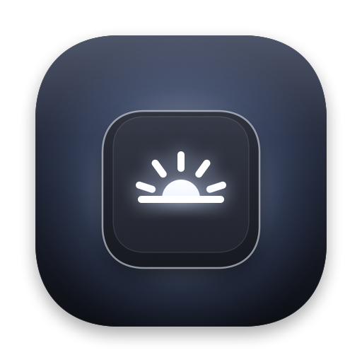
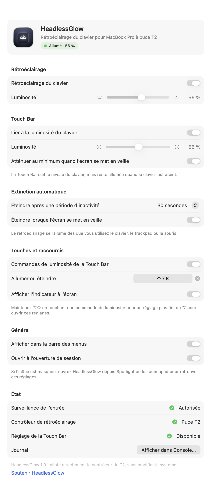
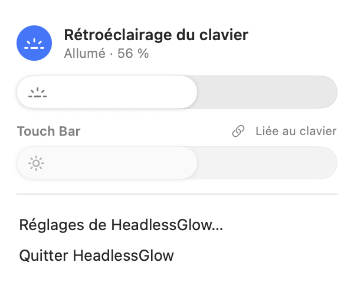

<div align="center">



# HeadlessGlow

Rétroéclairage du clavier et luminosité de la Touch Bar pour les MacBook Pro à puce T2 sans écran.

[](https://github.com/OnixBrave/HeadlessGlow/actions/workflows/build.yml)
[](https://github.com/OnixBrave/HeadlessGlow/releases/latest)
[](#compatibilité)
[](LICENSE)
[](https://github.com/OnixBrave/HeadlessGlow/stargazers)
[](#soutenir-le-projet)

[Télécharger](https://github.com/OnixBrave/HeadlessGlow/releases/latest) · [Installation](#installation) · [Utilisation](#utilisation) · [Soutenir](#soutenir-le-projet)

[English](README.md) · Français · [Español](README.es.md) · [Deutsch](README.de.md) · [Italiano](README.it.md) · [Português](README.pt-BR.md) · [Русский](README.ru.md) · [简体中文](README.zh-CN.md) · [日本語](README.ja.md)

<br>

<picture>
  <source media="(prefers-color-scheme: dark)" srcset="docs/fr/settings-dark.png">
  
</picture>
&nbsp;&nbsp;
<picture>
  <source media="(prefers-color-scheme: dark)" srcset="docs/fr/menu-dark.png">
  
</picture>

</div>

## Pourquoi

Retirer l’écran d’un MacBook Pro à puce T2 retire aussi le capteur de lumière ambiante, placé sur la carte de la caméra. macOS cesse alors de piloter le rétroéclairage du clavier : les touches de luminosité ne font plus rien et le clavier reste éteint. HeadlessGlow pilote le rétroéclairage directement par la puce T2.

## Fonctions

- Rétroéclairage allumé à l’ouverture de session, rétabli après la veille, éteint quand l’écran se met en veille
- Touches de luminosité de la Touch Bar : 16 paliers, <kbd>⌥</kbd><kbd>⇧</kbd> pour un réglage fin, <kbd>⌥</kbd> pour ouvrir les réglages
- Extinction après une période d’inactivité, rallumage à la première touche ou au premier mouvement de souris
- Raccourci de bascule (<kbd>⌃</kbd><kbd>⌥</kbd><kbd>K</kbd> par défaut)
- Atténuation de la Touch Bar, éventuellement liée au niveau du clavier
- Panneau dans la barre des menus, fenêtre de réglages et indicateur à l’écran
- Commande `headlessglow` pour le Terminal
- Multilingue

## Compatibilité

MacBook Pro Intel à puce T2 (2018–2020), macOS 13 ou plus récent.

| macOS | État |
|---|---|
| 26 | Testé sur un MacBookPro16,1 (16 pouces, 2019) |
| 15 | [Tests de lancement automatiques](https://github.com/OnixBrave/HeadlessGlow/actions/workflows/build.yml) réussis |
| 13, 14 | Compilé, non testé |

Les retours sur d’autres modèles sont bienvenus dans les [issues](https://github.com/OnixBrave/HeadlessGlow/issues).

## Installation

Depuis une release : téléchargez le zip sur la [page des releases](https://github.com/OnixBrave/HeadlessGlow/releases/latest), ouvrez-le, puis lancez :

```sh
cd ~/Downloads/HeadlessGlow-<version> && ./install.sh
```

Depuis le code source (Xcode 26 nécessaire) :

```sh
git clone https://github.com/OnixBrave/HeadlessGlow.git && cd HeadlessGlow
./tools/setup-signing.sh   # facultatif : conserve l’autorisation entre les mises à jour
./install.sh
```

Autorisez ensuite HeadlessGlow dans *Réglages Système → Confidentialité et sécurité → Surveillance de l’entrée*. Ce n’est utile que pour les touches de la Touch Bar, lues en écoute seule.

> [!NOTE]
> L’app n’est pas notarisée : `install.sh` retire donc l’attribut de quarantaine de l’app qu’il installe. Les releases sont signées ad hoc : macOS redemande l’autorisation après chaque mise à jour.

<details>
<summary>Ce qui est installé</summary>
<br>

Tout va dans votre dossier personnel, sans `sudo`.

| Quoi | Où |
|---|---|
| App | `~/Applications/HeadlessGlow.app` |
| Commande | `~/.local/bin/headlessglow` |
| Service d’ouverture de session | `~/Library/LaunchAgents/io.github.onixbrave.headlessglow.plist` |
| Réglages | `defaults read io.github.onixbrave.headlessglow` |
| Journal | `~/Library/Logs/HeadlessGlow.log` |

`setup-signing.sh` crée un certificat de signature de code auto-signé dans votre trousseau de session, pour que l’app garde la même identité d’une compilation à l’autre. `uninstall.sh` le supprime.

</details>

## Utilisation

Utilisez les commandes de luminosité du clavier de la Touch Bar, l’icône de la barre des menus, le raccourci, ou le Terminal :

```text
headlessglow get                  affiche l’état
headlessglow set <0-100>          règle le niveau (0 éteint)
headlessglow on | off | toggle
headlessglow touchbar <10-100 | lier | délier>
headlessglow reload               relit les réglages après un `defaults write`
```

Si vous masquez l’icône de la barre des menus, ouvrez HeadlessGlow depuis Spotlight pour retrouver les réglages.

## Fonctionnement

Le T2 expose le rétroéclairage sous forme d’interfaces HID propriétaires du périphérique `05AC:8102`. HeadlessGlow leur envoie des rapports Feature, les mêmes que le driver Linux `hid-apple`. Rien n’est écrit de façon permanente, et il ne faut ni modification de SIP, ni extension noyau, ni droits administrateur.

<details>
<summary>Détails</summary>
<br>

| Interface | Rapport | Contenu |
|---|---|---|
| `0xFF00:0x0F` (clavier) | ID 1 | luminosité `u32` (100…14660), fondu `u32` (ms) |
| | ID 3 | alimentation `u8` (0/1), fondu `u32` (ms) |
| `0xFF12:0x01` (Touch Bar) | ID 1 | état, palier d’atténuation, facteur de luminosité `u32` (0…1000) |

Le facteur de la Touch Bar permet seulement de l’atténuer ; macOS le réécrit aussi quand il l’atténue lui-même, donc HeadlessGlow réapplique le réglage après chaque réveil. La détection d’inactivité utilise `HIDIdleTime`, et les touches de luminosité sont lues par une écoute d’événements en lecture seule.

</details>

## Désinstallation

```sh
./uninstall.sh
```

Retire l’app, la commande, le service, les réglages, l’autorisation, le certificat de signature et les journaux.

<details>
<summary>Dépannage</summary>
<br>

- `headlessglow get` affiche ce que rapporte le T2.
- La section *État* des réglages montre l’autorisation et les contrôleurs, et ouvre le journal.
- Journal détaillé : `defaults write io.github.onixbrave.headlessglow debugLog -bool YES`, puis `headlessglow reload`.

</details>

<details>
<summary>Développement</summary>
<br>

- `./build.sh` compile l’app ; `./tools/package.sh` crée le zip de release. Pousser une étiquette `v*` compile, teste et publie une release via GitHub Actions.
- `./tools/update-strings.sh` synchronise le catalogue de traductions avec le code.
- `headlessglow --snapshot <dossier>` enregistre les fenêtres de l’app en PNG.
- L’accès au matériel est dans `src/core/kbhw.c` ; l’app est en Swift et SwiftUI.

</details>

## Crédits

- Format des rapports du clavier : le driver Linux `hid-apple` et la communauté [t2linux](https://t2linux.org).
- [KBPulse](https://github.com/EthanRDoesMC/KBPulse) d’EthanRDoesMC, pour le travail préalable sur CoreBrightness.

## Soutenir le projet

HeadlessGlow est gratuit. Les dons sont bienvenus :

| Monnaie | Réseau | Adresse |
|---|---|---|
| Bitcoin | Bitcoin | `bc1qsmpzq2hzruf2lgpexz4wtg0p0c0t8uxujnckfw` |
| ETH, USDC, USDT | Ethereum, Base, Arbitrum, Optimism | `0x2860E6465E03E714e4eCa092DcaeCCE2CE601D1C` |
| Litecoin | Litecoin | `LeDfGzBNgJGJURon1LCizT9n8LshTThBjD` |

Vérifiez le réseau avant d’envoyer. Mettre une étoile au dépôt aide aussi.

## Avertissement

HeadlessGlow utilise des interfaces matérielles non documentées et n’a été testé que sur un modèle. Utilisation à vos risques. Sans lien avec Apple.

## Licence

[MIT](LICENSE) © 2026 OnixBrave
