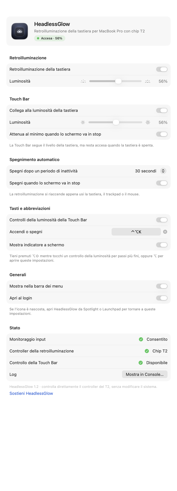
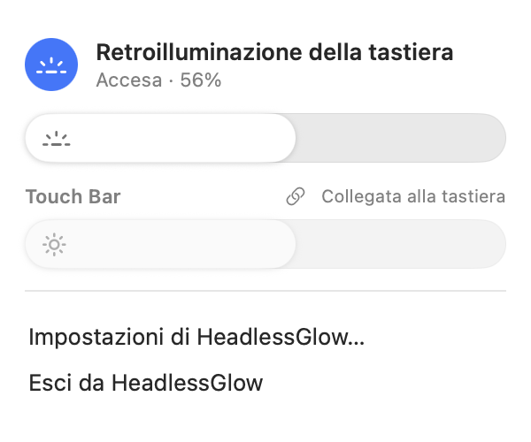

<div align="center">


# HeadlessGlow

Retroilluminazione della tastiera e luminosità della Touch Bar per MacBook Pro con chip T2 senza schermo.

[](https://github.com/OnixBrave/HeadlessGlow/actions/workflows/build.yml)
[](https://github.com/OnixBrave/HeadlessGlow/releases/latest)
[](#compatibilità)
[](LICENSE)
[](https://github.com/OnixBrave/HeadlessGlow/stargazers)
[](#sostieni-il-progetto)

[Scarica](https://github.com/OnixBrave/HeadlessGlow/releases/latest) · [Installazione](#installazione) · [Utilizzo](#utilizzo) · [Sostieni](#sostieni-il-progetto)

[English](README.md) · [Français](README.fr.md) · [Español](README.es.md) · [Deutsch](README.de.md) · Italiano · [Português](README.pt-BR.md) · [Русский](README.ru.md) · [简体中文](README.zh-CN.md) · [日本語](README.ja.md)

<br>

<picture>
  <source media="(prefers-color-scheme: dark)" srcset="docs/it/settings-dark.png">
  
</picture>
&nbsp;&nbsp;
<picture>
  <source media="(prefers-color-scheme: dark)" srcset="docs/it/menu-dark.png">
  
</picture>

</div>

## Perché

Rimuovendo lo schermo di un MacBook Pro con chip T2 si rimuove anche il sensore di luce ambientale, che si trova sulla scheda della fotocamera. macOS smette allora di gestire la retroilluminazione della tastiera: i tasti della luminosità non fanno nulla e la tastiera resta spenta. HeadlessGlow controlla la retroilluminazione direttamente tramite il chip T2.

## Funzioni

- Retroilluminazione accesa al login, ripristinata dopo lo stop, spenta quando lo schermo va in stop
- Tasti della luminosità della Touch Bar: 16 livelli, <kbd>⌥</kbd><kbd>⇧</kbd> per passi più fini, <kbd>⌥</kbd> per aprire le impostazioni
- Si spegne dopo un periodo di inattività e si riaccende alla prima pressione di un tasto o al primo movimento del mouse
- Scorciatoia per accendere e spegnere (predefinita <kbd>⌃</kbd><kbd>⌥</kbd><kbd>K</kbd>)
- Attenuazione della Touch Bar, facoltativamente collegata al livello della tastiera
- Pannello nella barra dei menu, finestra delle impostazioni e indicatore a schermo
- Strumento da riga di comando `headlessglow`
- Multilingue

## Compatibilità

MacBook Pro Intel con chip T2 (2018–2020), macOS 13 o successivo.

| macOS | Stato |
|---|---|
| 26 | Testato su un MacBookPro16,1 (16 pollici, 2019) |
| 15 | [Test di avvio automatici](https://github.com/OnixBrave/HeadlessGlow/actions/workflows/build.yml) superati |
| 13, 14 | Compila, non testato |

I risultati su altri modelli sono benvenuti nelle [issue](https://github.com/OnixBrave/HeadlessGlow/issues).

## Installazione

Da una release: scarica lo zip dalla [pagina delle release](https://github.com/OnixBrave/HeadlessGlow/releases/latest), aprilo ed esegui:

```sh
cd ~/Downloads/HeadlessGlow-<version> && ./install.sh
```

Dal codice sorgente (richiede Xcode 26):

```sh
git clone https://github.com/OnixBrave/HeadlessGlow.git && cd HeadlessGlow
./tools/setup-signing.sh   # facoltativo: mantiene il permesso tra un aggiornamento e l'altro
./install.sh
```

Poi consenti HeadlessGlow in *Impostazioni di Sistema → Privacy e sicurezza → Monitoraggio input*. Serve solo per i tasti della Touch Bar, che vengono letti in modalità di solo ascolto.

> [!NOTE]
> L'app non è notarizzata, quindi `install.sh` rimuove l'attributo di quarantena dall'app che installa. Le release sono firmate ad hoc: macOS richiede di nuovo il permesso dopo ogni aggiornamento.

<details>
<summary>Cosa viene installato</summary>
<br>

Tutto va nella tua cartella Inizio, senza `sudo`.

| Cosa | Dove |
|---|---|
| App | `~/Applications/HeadlessGlow.app` |
| Comando | `~/.local/bin/headlessglow` |
| Servizio di login | `~/Library/LaunchAgents/io.github.onixbrave.headlessglow.plist` |
| Impostazioni | `defaults read io.github.onixbrave.headlessglow` |
| Log | `~/Library/Logs/HeadlessGlow.log` |

`setup-signing.sh` crea un certificato di firma del codice autofirmato nel portachiavi login, così l'app mantiene la stessa identità tra una build e l'altra. `uninstall.sh` lo rimuove.

</details>

## Utilizzo

Usa i controlli della luminosità della tastiera nella Touch Bar, l'icona nella barra dei menu, la scorciatoia o la riga di comando:

```text
headlessglow get                  mostra lo stato
headlessglow set <0-100>          imposta il livello (0 la spegne)
headlessglow on | off | toggle
headlessglow touchbar <10-100 | link | unlink>
headlessglow reload               rilegge le impostazioni dopo un `defaults write`
```

Se nascondi l'icona nella barra dei menu, apri HeadlessGlow da Spotlight per tornare alle impostazioni.

## Come funziona

Il T2 espone la retroilluminazione come interfacce HID proprietarie del dispositivo `05AC:8102`. HeadlessGlow invia loro dei feature report, gli stessi usati dal driver Linux `hid-apple`. Nulla viene scritto in modo permanente, e non servono modifiche a SIP, estensioni del kernel né privilegi di amministratore.

<details>
<summary>Dettagli</summary>
<br>

| Interfaccia | Report | Contenuto |
|---|---|---|
| `0xFF00:0x0F` (tastiera) | ID 1 | luminosità `u32` (100…14660), dissolvenza `u32` (ms) |
| | ID 3 | accensione `u8` (0/1), dissolvenza `u32` (ms) |
| `0xFF12:0x01` (Touch Bar) | ID 1 | stato, livello di attenuazione, fattore di luminosità `u32` (0…1000) |

Il fattore della Touch Bar può solo attenuarla; macOS lo riscrive anche quando attenua da solo la Touch Bar, quindi HeadlessGlow riapplica l'impostazione dopo ogni risveglio. Il rilevamento dell'inattività usa `HIDIdleTime` e i tasti della luminosità vengono letti con un event tap in solo ascolto.

</details>

## Disinstallazione

```sh
./uninstall.sh
```

Rimuove l'app, il comando, il servizio di login, le impostazioni, il permesso, il certificato di firma e i log.

<details>
<summary>Risoluzione dei problemi</summary>
<br>

- `headlessglow get` mostra ciò che riporta il T2.
- La sezione *Stato* delle impostazioni mostra il permesso e lo stato dei controller, e apre il log.
- Log dettagliato: `defaults write io.github.onixbrave.headlessglow debugLog -bool YES`, poi `headlessglow reload`.

</details>

<details>
<summary>Sviluppo</summary>
<br>

- `./build.sh` compila l'app; `./tools/package.sh` crea lo zip della release. Il push di un tag `v*` compila, testa e pubblica una release con GitHub Actions.
- `./tools/update-strings.sh` sincronizza il catalogo delle traduzioni con il codice.
- `headlessglow --snapshot <cartella>` salva le finestre dell'app in PNG.
- L'accesso all'hardware è in `src/core/kbhw.c`; l'app è scritta in Swift e SwiftUI.

</details>

## Riconoscimenti

- Formato dei report della tastiera: il driver Linux `hid-apple` e la comunità [t2linux](https://t2linux.org).
- [KBPulse](https://github.com/EthanRDoesMC/KBPulse) di EthanRDoesMC, per il lavoro preliminare su CoreBrightness.

## Sostieni il progetto

HeadlessGlow è gratuito. Le donazioni sono benvenute:

| Valuta | Rete | Indirizzo |
|---|---|---|
| Bitcoin | Bitcoin | `bc1qsmpzq2hzruf2lgpexz4wtg0p0c0t8uxujnckfw` |
| ETH, USDC, USDT | Ethereum, Base, Arbitrum, Optimism | `0x2860E6465E03E714e4eCa092DcaeCCE2CE601D1C` |
| Litecoin | Litecoin | `LeDfGzBNgJGJURon1LCizT9n8LshTThBjD` |

Controlla la rete prima di inviare. Anche una stella al repository aiuta.

## Avvertenze

HeadlessGlow usa interfacce hardware non documentate ed è stato testato su un solo modello. Usalo a tuo rischio. Non affiliato ad Apple.

## Licenza

[MIT](LICENSE) © 2026 OnixBrave
